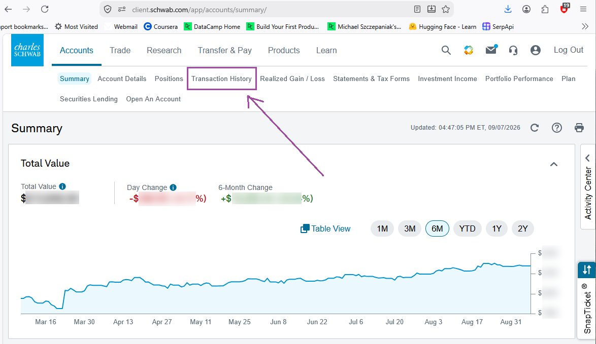
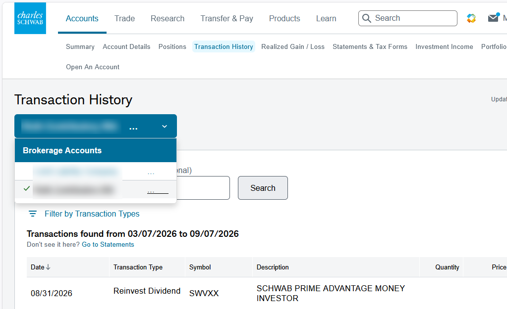
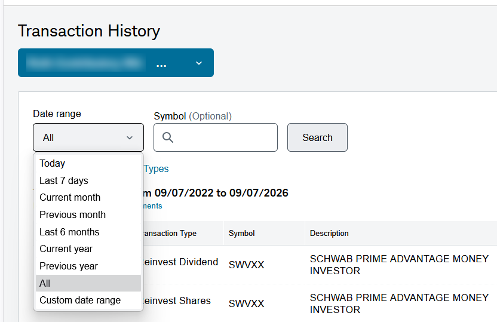
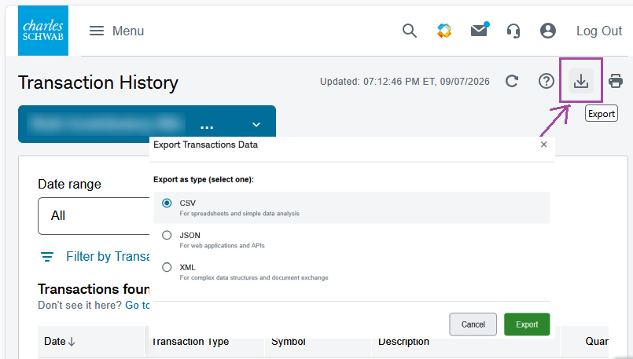

# Processing Schwab Transactions

## Obtaining the data

1. Login to account: https://client.schwab.com/Areas/Access/Login

2. From the home Summary page shown below, click **Transaction History**:

3. Select the account to retrieve the transaction history from:

4. Select the date range:

5. Click the `Export` icon and select the `CSV` as the file type:

## Cleaning the Schwab CSV file

As of 2026-09-07, the columns of this file were:  

| Date | Action | Symbol | Description | Quantity | Price | Fees & Comm | Amount |
|------|--------|--------|-------------|---------:|------:|-------------|--------|

These are similar to what we see with Vanguard transaction histories. One significant difference is that not all values in the `Date` column are just dates. Some rows contain values of the form:  `mm1/dd1/yyyy1 as of mm2/dd2/yyyy2` where:
+ mm1 and mm2 are 2-digit months
+ dd1 and dd2 are 2-digit days
+ yyyy1 and yyyy1 are 2-digit years

For example, some of the August 2026 transactions look like this:

| Date | Action | Symbol | Description | Quantity | Price | Fees & Comm | Amount |
|------|--------|--------|-------------|---------:|------:|------------:|-------:|
| 08/31/2026 | Reinvest Dividend | SWVXX | SCHWAB PRIME ADVANTAGE MONEY INVESTOR |  |  |  | $286.29 |
| 08/31/2026 | Reinvest Shares | SWVXX | SCHWAB PRIME ADVANTAGE MONEY INVESTOR | 286.29 | $1.00 |  | -$286.29 |
| 08/31/2026 | Reinvest Shares | FAX | ABRDN ASIA-PACIFIC INCOM | 1.4204 | $14.7003 |  | -$20.88 | 
| 08/31/2026 | Reinvest Dividend | FAX | ABRDN ASIA-PACIFIC INCOM |  |  |  | $20.88 |
| 08/28/2026 | Reinvest Shares | HYZD | WISDOMTREE INTEREST RATEHEDGED HIGH YIELD BOND FUND | 0.6896 | $22.6225	 |  | -$15.60 |
| 08/28/2026 as of 08/27/2026 | Cash In Lieu | SCCO | SOUTHERN COPPER CORP |  |  |  | $131.39
| 08/28/2026 | Reinvest Dividend | HYZD | WISDOMTREE INTEREST RATEHEDGED HIGH YIELD BOND FUND |  |  |  | $15.60 |
| 08/27/2026 | Reinvest Shares | SCCO | SOUTHERN COPPER CORP | 0.2605 | $218.0032 |  | -$56.79 |
| 08/27/2026 | Qual Div Reinvest | SCCO | SOUTHERN COPPER CORP |  |  |  | $56.79 |
| 08/17/2026 as of 08/15/2026 | Bank Interest |  | BANK INT ...526 TD BANK USA NA |  |  |  | $0.05 |

***NOTE: The dollar signs in the table needs to be escaped with a backslash when rendering in a jupyter notebook!!!***

### Trim the `Data` to the first 10 characters

TODO - describe **Date** column cleaning/processing...
