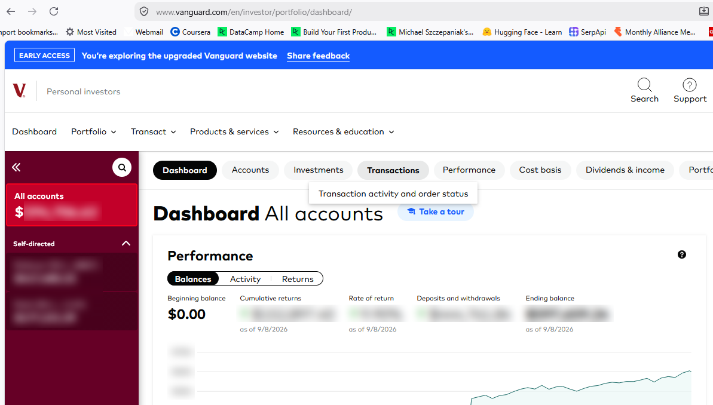
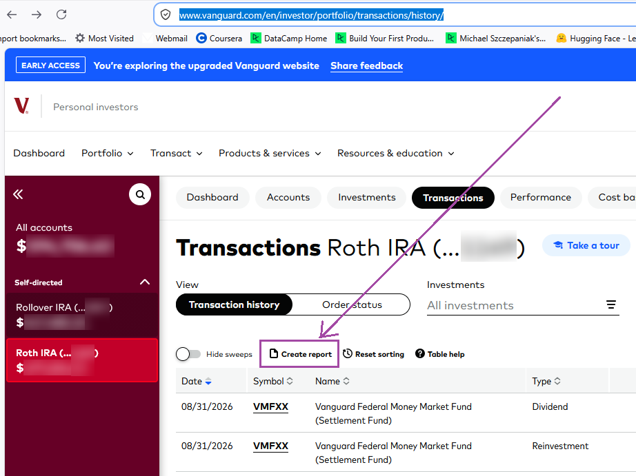
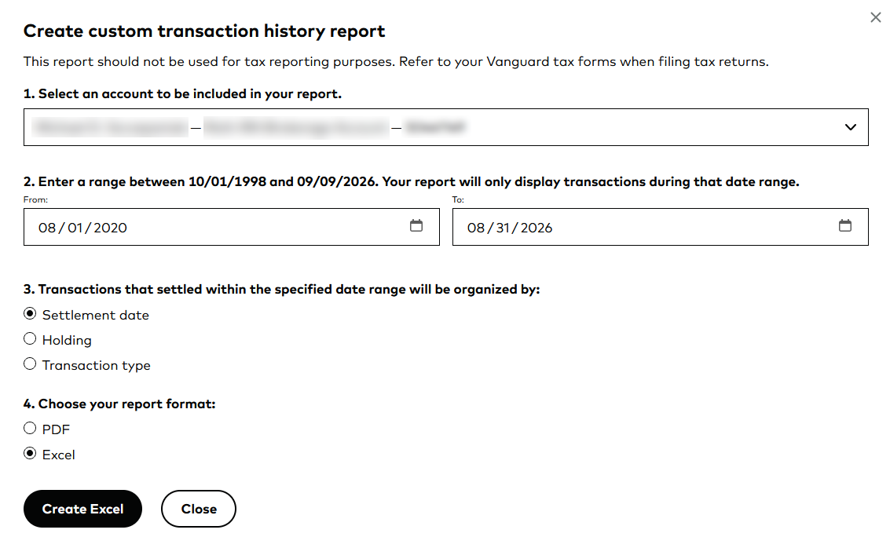

# Processing Vanguard Transactions

## Obtaining the data

1. Login to account: https://logon.vanguard.com/logon

2. From the ***Dashboard All accounts*** page shown below, click ***Transactions*** button:

3. Select an account and click the ***Create report*** link from the **Transactions** page:

4. Fill out the form to create the report selecting **Excel** as the report format and click the ***Create Excel*** button:

## Cleaning the Vanguard xlsx file

As of 2026-09-07, the columns of this file were:  

| Settlement date | Trade date | Symbol | Name | Transaction type | Account type | Quantity | Price | Commission & fees | Amount |
|-----------------|------------|--------|------|-----------------:|-------------:|---------:|------:|-------------------|-------:|

TODO

### TODO
